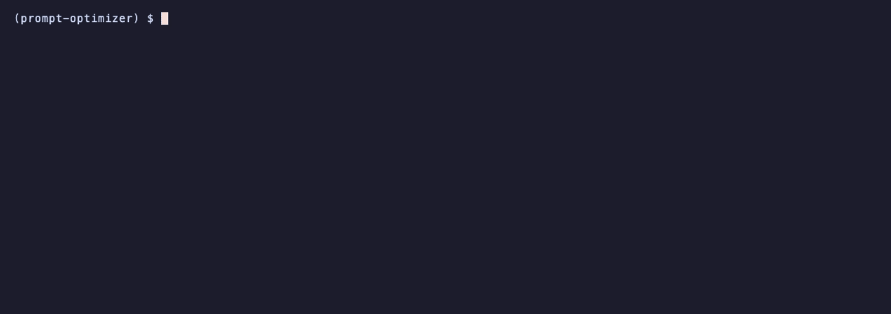
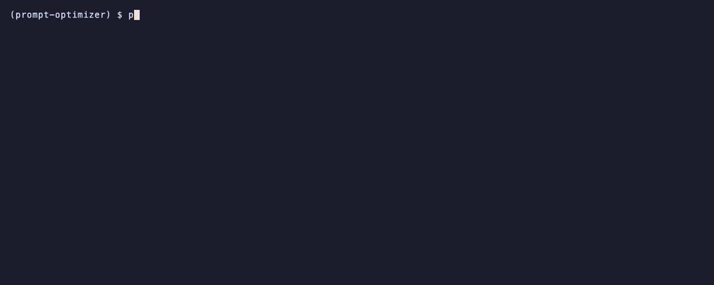
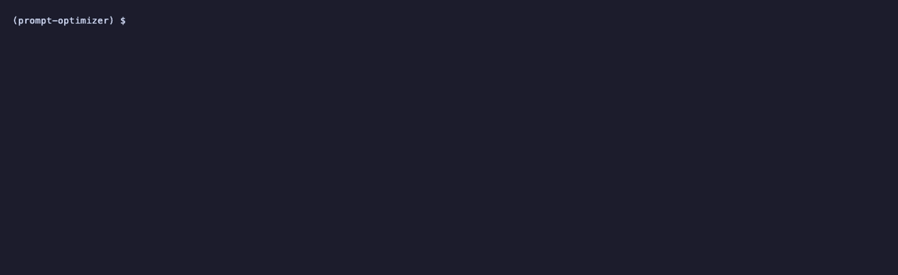

<h1 align="center">Prompt Optimizer</h1>

<p align="center">
  <em>Seven prompt optimizers from the literature, implemented in one code base and compared on local Qwen3.5 models and public reasoning benchmarks under equal budgets, with cost accounting, confidence intervals and a DSPy head-to-head.</em>
</p>

<p align="center">
  <a href="https://github.com/adeoluo/prompt-optimizer/actions/workflows/ci.yml"></a>
  <a href="https://github.com/adeoluo/prompt-optimizer/releases"></a>
  
  <a href="LICENSE"></a>
</p>

---

## Motivation

The instruction and the in-context examples of a prompt move accuracy as much as many model
changes do, and a growing literature treats them as parameters to optimize against a metric:
instruction induction (APE), LLM-as-optimizer (OPRO), Bayesian search over instructions and
demonstrations (MIPROv2), textual gradients (TextGrad), reflective evolution with Pareto
selection (GEPA), self-referential evolution (PromptBreeder) and bootstrapped few-shot
demonstrations. Papers report each method with different models, budgets and splits, so it
is hard to say which one helps, by how much, and at what cost.

This project implements all seven behind one contract (same seed prompt, same rollout
budget, same train, validation and test splits, same answer extraction), runs them on real
local models through llama.cpp (Qwen3.5-2B for optimization, Qwen3.5-0.8B for transfer) on
GSM8K and BIG-Bench Hard (MATH-500, HotpotQA and IFEval are implemented and tested, without
real-model runs yet), reports test accuracy with 95% bootstrap
intervals, paired tests against the seed prompt, validation to test gaps and the cost of
each search in model calls and tokens, and compares against DSPy 3.4.1 run on the same
model, splits and budget. The original from-scratch optimizers on a simulated model remain
as a small, deterministic reference.

## Architecture

<p align="center">
  
</p>

<sub>Legend: amber = entry points and external systems, indigo = core logic, green = data and state, blue = validation and control, grey = observability and outputs.</sub>

The experiment runner (or the CLI) loads a benchmark with fixed seeded splits and hands an
optimizer the seed program, the training and validation examples and a rollout budget. Every
optimizer works through one `OptimizerContext`, which scores candidate programs in batches,
memoizes (program, example) pairs, refuses batches that would overrun the budget and labels
proposer calls for accounting. All model calls go through `CachedLM`: a content-hash SQLite
cache in front of an async client that sends each batch concurrently to `llama-server`,
whose continuous batching serves the in-flight sequences together. The selected program is
scored on a fixed seeded prefix of the test split; per-example records feed the bootstrap
statistics, the validation to test comparison and the results tables. DSPy runs through the
same cached client, so its calls and tokens are counted identically. More detail is in
[docs/ARCHITECTURE.md](docs/ARCHITECTURE.md).

### Optimizers

| Method | Paper | What it searches | Mechanism in this repository | Module |
|---|---|---|---|---|
| Bootstrapped few-shot | Khattab et al., 2023 (DSPy) | demonstrations | teacher traces kept when correct; random search over demo sets on validation | `optim/bootstrap.py` |
| APE | Zhou et al., 2022 | instruction | induction from input/output pairs, shared-minibatch scoring, paraphrase resampling | `optim/ape.py` |
| OPRO | Yang et al., 2023 | instruction | meta-prompt with the scored trajectory in ascending order, several samples per step | `optim/opro.py` |
| MIPROv2-style | Opsahl-Ong et al., 2024 | instruction and demos jointly | grounded proposals, from-scratch categorical TPE over (instruction, demo set) on validation minibatches | `optim/mipro.py`, `optim/tpe.py` |
| TextGrad-style | Yuksekgonul et al., 2024 | instruction | textual gradient from failures with feedback, momentum, validation-gated step | `optim/textgrad.py` |
| GEPA-style | Agrawal et al., 2025 | instruction | reflective mutation on 3-example minibatches, per-instance Pareto pool and parent sampling | `optim/gepa.py`, `optim/pareto.py` |
| PromptBreeder-style | Fernando et al., 2023 | instruction and mutation prompt | binary tournament; zero and first order, EDA, lineage, hypermutation, Lamarckian and crossover operators | `optim/promptbreeder.py` |

Each module's docstring states the method's math or loop and what was scaled down
([ADR-0008](docs/adr/0008-one-optimizer-contract.md)).

## Results

Every number in this section is a real run of Qwen3.5-2B (Unsloth Q4_K_M GGUF on llama.cpp,
thinking off, greedy task rollouts) on one shared Apple M1 with 8 GB. All eight methods
start from the same seed prompt, get the same budget of 400 task rollouts on the same
training and validation splits, use one optimization seed (0) and never see the test split.
Intervals are 95% percentile bootstraps over test examples; differences and p-values are
paired bootstraps against the seed prompt on the same examples. Each table is regenerated
from the committed per-example files in `benchmarks/results/` by
`python -m prompt_optimizer report`, and rerunning the experiments replays every model call
from the response cache (commands under [Experiments](#experiments)).

On GSM8K with Qwen3.5-2B, TextGrad-style search raises test accuracy from 64.7% (seed
prompt) to 75.0%, +10.3 points [4.7, 16.0], p < 0.001, using 399 task rollouts and 0.13M
tokens; it is the only method whose gain survives a correction for the seven comparisons.
OPRO (+6.0), GEPA-style (+5.3) and PromptBreeder-style (+5.0) gain about half as much, and
MIPROv2-style, despite tying for the best validation score, tests below the seed prompt. On
BIG-Bench Hard, where one prompt serves 27 tasks, no method beats the seed prompt.

### GSM8K, Qwen3.5-2B (300 test problems)

| Method | Val acc | Test acc [95% CI] | Diff vs seed [95% CI] | p | Truncated | Task rollouts | Proposer calls | Opt. tokens |
|---|---:|---:|---:|---:|---:|---:|---:|---:|
| Seed prompt (zero-shot) | 76.7 | 64.7 [59.3, 70.0] |  |  | 1.3% | 60 | 0 | 0.01M |
| Bootstrapped few-shot (random search) | 81.7 | 68.0 [62.7, 73.3] | 3.3 [-2.3, 9.0] | 0.274 | 1.7% | 400 | 0 | 0.27M |
| APE | 81.7 | 65.0 [59.7, 70.3] | 0.3 [-5.3, 6.0] | 0.945 | 1.3% | 388 | 12 | 0.13M |
| OPRO | 83.3 | 70.7 [65.3, 75.7] | 6.0 [1.0, 11.0] | 0.019 | 1.0% | 390 | 18 | 0.16M |
| MIPROv2-style | 86.7 | 64.0 [58.7, 69.3] | -0.7 [-6.0, 4.7] | 0.839 | 0.0% | 320 | 6 | 0.15M |
| TextGrad-style | 86.7 | 75.0 [69.7, 79.7] | 10.3 [4.7, 16.0] | 0.000 | 3.0% | 399 | 10 | 0.13M |
| GEPA-style | 85.0 | 70.0 [64.7, 75.0] | 5.3 [-0.3, 11.0] | 0.072 | 1.3% | 356 | 20 | 0.18M |
| PromptBreeder-style | 86.7 | 69.7 [64.3, 74.7] | 5.0 [-0.3, 10.3] | 0.088 | 4.7% | 348 | 19 | 0.14M |

Test examples: 300 shared by every row (of 1319 available). Accuracy in percent; intervals are 95% percentile bootstrap over examples (10,000 resamples); differences and p-values are paired bootstrap against the seed prompt on the same examples. Truncated is the share of test answers cut off by the task's max_tokens (scored wrong when no final answer was reached).

TextGrad-style search is the only method whose gain survives a correction for the seven
comparisons with the seed prompt (Holm, family-wise 5%): 75.0% against 64.7%, a paired
difference of +10.3 points [4.7, 16.0], p < 0.001. OPRO (+6.0, p = 0.019) is significant on
its own but not after the correction; GEPA-style (+5.3, p = 0.07) and PromptBreeder-style
(+5.0, p = 0.09) are borderline; bootstrapped few-shot (+3.3) and APE (+0.3) are within
noise. MIPROv2-style tied for the best validation score and tested below the seed prompt.

Every winning program is an instruction without demonstrations. TextGrad-style rewrote the
instruction from critiques of failed examples into an ordering rule ("perform all arithmetic
operations first ... state the scenario logic only after all calculations are complete");
the rewrite step's `<solution>` wrapper was kept verbatim in the instruction, which the
model ignores. OPRO converged on restating the output contract step by step, and GEPA-style
and PromptBreeder-style on longer role and rule lists. Demonstrations did not help
here: the two programs that use them (bootstrapped few-shot with two, MIPROv2-style with
one) are not significantly better than the seed prompt.

### BIG-Bench Hard, Qwen3.5-2B (27 tasks, 270 test examples)

| Method | Val acc | Test acc [95% CI] | Diff vs seed [95% CI] | p | Truncated | Task rollouts | Proposer calls | Opt. tokens |
|---|---:|---:|---:|---:|---:|---:|---:|---:|
| Seed prompt (zero-shot) | 61.1 | 49.6 [43.7, 55.6] |  |  | 6.7% | 54 | 0 | 0.02M |
| Bootstrapped few-shot (random search) | 61.1 | 49.6 [43.7, 55.6] | 0.0 [0.0, 0.0] | 1.000 | 6.7% | 378 | 0 | 0.18M |
| APE | 61.1 | 49.6 [43.7, 55.6] | 0.0 [0.0, 0.0] | 1.000 | 6.7% | 316 | 12 | 0.14M |
| OPRO | 61.1 | 49.6 [43.7, 55.6] | 0.0 [0.0, 0.0] | 1.000 | 6.7% | 333 | 21 | 0.19M |
| MIPROv2-style | 61.1 | 49.6 [43.7, 55.6] | 0.0 [0.0, 0.0] | 1.000 | 6.7% | 274 | 6 | 0.14M |
| TextGrad-style | 64.8 | 51.1 [45.2, 57.0] | 1.5 [-4.1, 7.0] | 0.653 | 7.0% | 392 | 14 | 0.18M |
| GEPA-style | 61.1 | 49.6 [43.7, 55.6] | 0.0 [0.0, 0.0] | 1.000 | 6.7% | 398 | 22 | 0.24M |
| PromptBreeder-style | 61.1 | 49.6 [43.7, 55.6] | 0.0 [0.0, 0.0] | 1.000 | 6.7% | 258 | 14 | 0.16M |

Test examples: 270 shared by every row (of 405 available). Accuracy in percent; intervals are 95% percentile bootstrap over examples (10,000 resamples); differences and p-values are paired bootstrap against the seed prompt on the same examples. Truncated is the share of test answers cut off by the task's max_tokens (scored wrong when no final answer was reached).

One instruction is shared by all 27 tasks, which mix logical deduction, date arithmetic,
word sorting and boolean evaluation, and the seed instruction ("Answer the question.")
relies on each example's own task framing. Against that seed, six of seven methods found no
candidate that beat it on the 54-example validation set and returned it unchanged, so their
test rows equal the seed's. Their searches did run: GEPA-style accepted four candidates on
three-example minibatches (scores up to 1.0) that then scored 38.9 to 57.4 on full
validation, and MIPROv2-style's best minibatch trial (75.0 on 20 examples) scored 51.9 on
full validation. TextGrad-style's selected program is the seed instruction wrapped in
`<system_prompt>` tags; it gained 3.7 points on validation and 1.5 on test (p = 0.65), which
is noise. Per-task prompts, the usual setup for BIG-Bench Hard, are on the roadmap.

### Against DSPy 3.4.1 on GSM8K

| Method | Implementation | Test acc [95% CI] | Diff vs own zero-shot [95% CI] | In-repo minus DSPy [95% CI] | p | Task rollouts | Proposer calls | Opt. tokens |
|---|---|---:|---:|---:|---:|---:|---:|---:|
| Zero-shot | Seed prompt (zero-shot) (this repository) | 64.7 [59.3, 70.0] |  |  |  | 60 | 0 | 0.01M |
| Zero-shot | DSPy ChainOfThought (zero-shot) (dspy 3.4.1) | 67.0 [61.7, 72.3] |  | -2.3 [-7.3, 2.7] | 0.406 | 60 | 0 | 0.02M |
| Bootstrapped few-shot | Bootstrapped few-shot (random search) (this repository) | 68.0 [62.7, 73.3] | 3.3 [-2.3, 9.0] |  |  | 400 | 0 | 0.27M |
| Bootstrapped few-shot | DSPy BootstrapFewShotWithRandomSearch (dspy 3.4.1) | 69.7 [64.3, 74.7] | 2.7 [-2.7, 8.0] | -1.7 [-7.0, 3.7] | 0.559 | 440 | 0 | 0.41M |
| MIPROv2 | MIPROv2-style (this repository) | 64.0 [58.7, 69.3] | -0.7 [-6.0, 4.7] |  |  | 320 | 6 | 0.15M |
| MIPROv2 | DSPy MIPROv2 (dspy 3.4.1) | 69.7 [64.3, 74.7] | 2.7 [-2.3, 7.7] | -5.7 [-11.0, -0.3] | 0.046 | 499 | 29 | 0.45M |

Test examples: 300 shared by every row. Accuracy in percent with 95% bootstrap intervals; the gain column is paired against the same implementation's zero-shot program, the head-to-head column is paired in-repo minus DSPy.

DSPy 3.4.1 ran on the same model, server, splits and test prefix, through this
repository's cached and metered client, so calls and tokens are counted the same way. DSPy
formats prompts differently (field markers and a separate reasoning field), so each
implementation is compared with its own zero-shot program as well as head to head. DSPy's
zero-shot ChainOfThought scores 67.0 against the in-repo seed prompt's 64.7, and its
BootstrapFewShotWithRandomSearch 69.7 against the in-repo bootstrapped few-shot's 68.0;
neither difference is significant (p = 0.41 and 0.56). DSPy's random search has no rollout
cap: with three candidate programs it used 440 task rollouts, 10% more than the in-repo
methods' budget. DSPy's MIPROv2 also has no hard cap (its trial count and minibatch size set the cost): it
used 499 task rollouts, 29 proposer calls and 0.45M tokens, against 320 rollouts, 6 proposer
calls and 0.15M tokens for the in-repo MIPROv2-style run. It scores 69.7, which is 5.7
points [0.3, 11.0] above the in-repo MIPROv2-style program (p = 0.046), the one significant
head-to-head difference, and 2.7 points [-2.3, 7.7] above DSPy's own zero-shot program.
Both MIPROv2 runs scored well on validation (83.3 and 86.7); the in-repo run lost more of it
on test (22.7 points against 13.6), so with these budgets DSPy's longer search selected a
program that generalized better.

### Transfer to Qwen3.5-0.8B

The programs optimized on Qwen3.5-2B, scored unchanged with Qwen3.5-0.8B on the same test
examples (paired differences against the seed prompt on 0.8B):

GSM8K (300 problems):

| Method | qwen3.5-0.8b | qwen3.5-2b |
|---|---:|---:|
| Seed prompt (zero-shot) | 40.3 [34.7, 46.0] | 64.7 [59.3, 70.0] |
| MIPROv2-style | 33.3 [28.0, 38.7] | 64.0 [58.7, 69.3] |
| TextGrad-style | 45.0 [39.3, 50.7] | 75.0 [69.7, 79.7] |
| PromptBreeder-style | 44.7 [39.0, 50.0] | 69.7 [64.3, 74.7] |

Programs optimized on qwen3.5-2b. Shared test examples per model: qwen3.5-0.8b: 300, qwen3.5-2b: 300.

BIG-Bench Hard (270 examples):

| Method | qwen3.5-0.8b | qwen3.5-2b |
|---|---:|---:|
| Seed prompt (zero-shot) | 36.3 [30.7, 42.2] | 49.6 [43.7, 55.6] |
| TextGrad-style | 34.4 [28.9, 40.0] | 51.1 [45.2, 57.0] |

Programs optimized on qwen3.5-2b. Shared test examples per model: qwen3.5-0.8b: 270, qwen3.5-2b: 270.

The two instruction rewrites that helped on 2B also help on 0.8B, by about half as much and
no longer significantly: TextGrad-style +4.7 points [-1.0, 10.3] (p = 0.12) and
PromptBreeder-style +4.3 [-1.3, 10.0] (p = 0.16). MIPROv2-style's program, level with the
seed prompt on 2B, hurts on 0.8B: -7.0 points [-13.0, -0.7] (p = 0.03). On BIG-Bench Hard,
TextGrad-style's 2B gain does not carry over (-1.9 points, p = 0.57).

### Cost of the search

Task rollouts are capped at 400 per run and counted before every batch; proposer calls
(instruction proposals, critiques, reflections, mutations) are counted but not capped and
are cheap next to the rollouts: 0 to 22 calls per run. Optimization tokens range from
0.13M to 0.27M per run. On GSM8K bootstrapped few-shot is the most expensive (0.27M),
because its candidate programs carry demonstrations into every rollout, and TextGrad-style,
the best method there, is among the cheapest (0.13M); on BIG-Bench Hard GEPA-style is the
most expensive (0.24M). Each run took 10 to 67 minutes of wall time on the shared M1 at about
45 completion tokens per second across 8 parallel requests; wall time also depends on how
many calls were already in the response cache, so the token counts are the comparable
measure.

### Benchmarks, splits and coverage

| Benchmark | Train | Validation | Test available | Test scored | Real-model results |
|---|---:|---:|---:|---:|---|
| GSM8K | 200 | 60 | 1,319 | 300 (seeded prefix) | yes: eight methods, DSPy, transfer |
| BIG-Bench Hard | 216 | 54 | 405 | 270 (10 per task) | yes: eight methods, transfer |
| MATH-500 | 200 | 100 | 500 |  | not yet (loader, scoring and tests) |
| HotpotQA (distractor) | 150 | 100 | 500 |  | not yet (loader, scoring and tests) |
| IFEval | 100 | 100 | 341 |  | not yet (loader, 25 checkers and tests) |

MATH-500, HotpotQA (distractor) and IFEval are implemented end to end (download with
checksums, seeded splits, answer extraction, scoring, the 25 IFEval instruction checkers,
proposer feedback) and covered by offline tests, and every optimizer runs on them with
`--task math500`, `--task hotpotqa` or `--task ifeval`. They have no real-model results in
this release: on the shared M1 the GSM8K and BIG-Bench Hard comparisons used the compute
budget, and the README reports only what was run.

### Reference pipeline (simulated model)

The original from-scratch optimizers run on a deterministic simulated model and a
three-class intent task; they remain as a small, offline reference
(`python -m prompt_optimizer evaluate`).

| Method | Demonstrations | Test accuracy |
|---|---:|---:|
| Baseline (naive, zero-shot) | 0 | 0.333 |
| Instruction search | 0 | 0.833 |
| Few-shot bootstrap | 3 | 0.833 |
| Compound (instruction plus few-shot) | 1 | 1.000 |

On six test messages, each search dimension lifts accuracy on its own and the compound
optimizer reaches 1.000. Its scaling run (600 synthetic tasks, mean improvement +0.59) and
service latency are in [docs/SCALING.md](docs/SCALING.md) and
[docs/OPERATIONS.md](docs/OPERATIONS.md).

## Quickstart

```bash
git clone https://github.com/adeoluo/prompt-optimizer.git && cd prompt-optimizer
make setup                     # uv sync plus pre-commit hooks
make all                       # lint, type-check, tests with the coverage gate

# offline: any optimizer against the deterministic fake model
python -m prompt_optimizer optimizers
python -m prompt_optimizer optimize --fake --optimizer gepa --budget 300

# real model: download the benchmarks and start llama.cpp with Qwen3.5-2B
uv run --with pyarrow python scripts/download_data.py
llama-server -hf unsloth/Qwen3.5-2B-GGUF:Q4_K_M --port 8091 -np 8 -c 16384 -kvu \
    --reasoning off -fa on -ctk q8_0 -ctv q8_0 --cache-ram 0
python -m prompt_optimizer optimize --task gsm8k --optimizer gepa --budget 400
```

## Usage

### CLI

| Command | What it does |
|---|---|
| `python -m prompt_optimizer optimizers` | list the optimizers with their papers |
| `python -m prompt_optimizer optimize --task T --optimizer O --budget N [--fake] [--set key=value]` | run one optimizer and print the validation trajectory, the selected prompt and its cost |
| `python -m prompt_optimizer report` | render every results table from `benchmarks/results/` |
| `python -m prompt_optimizer evaluate`, `compile`, `predict`, `serve` | the reference pipeline on the simulated model |

### Library

```python
from prompt_optimizer.backends import CachedLM, LlamaCppLM, ResponseCache
from prompt_optimizer.optim import Budget, build
from prompt_optimizer.tasks.registry import load_task

task, splits = load_task("gsm8k")
lm = CachedLM(LlamaCppLM("http://127.0.0.1:8091", "qwen3.5-2b"), ResponseCache("lm.sqlite"))
result = build("gepa").compile(task, lm, splits.train, splits.val, budget=Budget(400), seed=0)
print(result.val_score, result.program.instruction, result.rollouts_used)
```

Any object with `model_id` and `generate(requests) -> responses` is a model
(`backends/base.py`); `FakeLM` is the deterministic test double.

### Experiments

```bash
# optimize and score on test (resumable; every call is cached); BBH uses --test-limit 270
python benchmarks/run_experiments.py --task gsm8k --budget 400 --test-limit 300 \
    --optimizers seed bootstrap_fewshot ape opro miprov2 textgrad gepa promptbreeder
# transfer: score the 2B-optimized programs on another model (the script swaps servers)
python benchmarks/run_experiments.py --task gsm8k --optimizers seed textgrad miprov2 promptbreeder \
    --eval-model qwen3.5-0.8b --test-limit 300 --transfer-only
# DSPy 3.4.1 on the same model, splits and budget
uv run --group compare python benchmarks/dspy_compare.py --task gsm8k --budget 400 \
    --test-limit 300 --optimizers seed bootstrap_rs miprov2
python -m prompt_optimizer report
```

### HTTP service

The reference pipeline also ships a standard-library HTTP service (`serve`) with
`/predict`, `/compile`, `/health`, `/ready` and `/metrics`; see
[docs/OPERATIONS.md](docs/OPERATIONS.md).

### Demos

Recorded from real runs with [vhs](https://github.com/charmbracelet/vhs); each tape is in `docs/demo/`.

The seven optimizers, then GEPA-style search against the deterministic fake model (no server needed).

<p align="center">
  
</p>

A finished Qwen3.5-2B GEPA-style run on GSM8K, replayed from the response cache: every model call is answered from disk, so the trajectory of accepted candidates and the selected prompt are the recorded ones.

<p align="center">
  
</p>

The results tables rendered from the committed per-example files: test accuracy with bootstrap intervals, paired differences against the seed prompt and the cost of each search.

<p align="center">
  
</p>

The reference pipeline on the simulated model: compiling a prompt by search, then a prediction with it.

<p align="center">
  
</p>

The reference ablation: the compiled prompt against the naive baseline.

<p align="center">
  
</p>

The reference HTTP service predicting with the compiled prompt.

<p align="center">
  
</p>

## Design decisions

- **Real models through llama.cpp, thinking off, batched.** ([ADR-0004](docs/adr/0004-local-models-through-llama-cpp.md))
- **The output contract belongs to the task**, so methods differ in reasoning, not parse rate. ([ADR-0005](docs/adr/0005-fixed-output-contract.md))
- **Content-hash cache with per-response writes**: free replays, resumable runs, identical cost columns on rerun. ([ADR-0006](docs/adr/0006-content-hash-cache-and-resumable-runs.md))
- **Equal rollout budgets and strict splits**, with the test split never visible to an optimizer. ([ADR-0007](docs/adr/0007-rollout-budget-and-split-discipline.md))
- **Seven optimizers behind one contract**, faithful to each paper's core loop. ([ADR-0008](docs/adr/0008-one-optimizer-contract.md))
- **DSPy through the same cached, metered client.** ([ADR-0009](docs/adr/0009-dspy-through-the-shared-client.md))
- **Bootstrap intervals and paired differences on shared examples.** ([ADR-0010](docs/adr/0010-paired-bootstrap-statistics.md))
- **A simulated model and metric-driven compilation for the reference pipeline.** ([ADR-0002](docs/adr/0002-simulated-language-model.md), [ADR-0003](docs/adr/0003-metric-driven-compilation.md), [ADR-0001](docs/adr/0001-record-architecture-decisions.md))

## Testing

```bash
make test                      # uv run pytest (offline, deterministic)
make coverage                  # with the coverage gate
uv run --group compare pytest tests/test_dspy_adapter.py   # DSPy adapter, needs dspy
```

The default suite has 299 offline, deterministic tests (coverage 97% of `src/`;
CI gate 80%), all run against `FakeLM`, a deterministic model whose accuracy rises with
better instructions and correct demonstrations, so every optimizer has a real signal to find:

- **Optimizer contract** (`test_optim.py`): for each of the seven optimizers, improvement over
  the seed, the rollout budget, determinism per seed, selection of the best validation score,
  a seed-only result on a tiny budget, and that no test example ever reaches the model; plus
  method-specific checks (OPRO trajectory order and history cap, MIPROv2 TPE trials and
  grounded proposals, TextGrad gradient and step prompts, GEPA reflection and crossover,
  every PromptBreeder operator, correct-and-untruncated bootstrapped traces).
- **Search components:** TPE (exploitation after start-up, smoothed densities, suggestions
  stay in the space under hypothesis), Pareto selection (fronts, dominance removal,
  proportional sampling, every front covered under hypothesis), demo-set sampling per group.
- **Statistics and runner** (`test_experiments.py`): bootstrap intervals against the normal
  approximation, paired bootstrap and McNemar (symmetry under hypothesis), nested test
  prefixes, resumable run and test files, report tables and the CLI.
- **Backends** (`test_backends.py`): request hashing, the SQLite cache, per-response cache
  writes, retries and permanent errors over a mock HTTP transport, cost accounting, the
  server command line.
- **Benchmarks** (`test_tasks.py`, `test_ifeval.py`): loaders, seeded disjoint splits, answer
  extraction and scoring for GSM8K, BIG-Bench Hard, MATH-500 and HotpotQA, and the IFEval
  instruction checkers.
- **Reference pipeline** (`test_core.py`, `test_optimizers.py`, `test_evaluation.py`,
  `test_service.py`).

Opt-in suites: `uv run --group compare pytest tests/test_dspy_adapter.py` checks the DSPy
adapter offline; `pytest -m integration` runs real calls against a running `llama-server`.
CI runs `ruff format --check`, `ruff check`, `mypy --strict src` and the tests on Python
3.12, 3.13, 3.14 and 3.15, then builds the wheel, sdist and Docker image.

## Responsible AI

- **Model card:** [docs/MODEL_CARD.md](docs/MODEL_CARD.md) (models used and their roles)
- **Data card:** [docs/DATA_CARD.md](docs/DATA_CARD.md) (sources, sizes, licenses, splits, contamination)
- **Threat model:** [docs/THREAT_MODEL.md](docs/THREAT_MODEL.md) (mapped to the OWASP Top 10 for LLM Applications 2026)
- **Evaluation report:** [docs/EVALUATION_REPORT.md](docs/EVALUATION_REPORT.md) (method, all results, threats to validity)

## Limitations

- **Compute-bound scale.** Every run used one shared 8 GB Apple M1 at about 50 completion
  tokens per second in aggregate for the 2B model, so each optimization run gets 400 task
  rollouts (papers often use thousands), GSM8K is scored on a seeded 300-problem prefix of
  its 1,319-problem test split and BIG-Bench Hard on 10 examples per task (270 of the 405
  held-out examples). The full GSM8K test and the remaining BIG-Bench Hard examples are not
  yet scored.
- **Two of five benchmarks have real-model results.** MATH-500, HotpotQA and IFEval are
  implemented, split and tested (loaders, answer extraction, scoring, the 25 IFEval
  checkers) but have no real-model runs yet.
- **One optimization seed.** Bootstrap intervals cover test-sample variance, not the
  randomness of the search; a method's rank can change with another seed.
- **Small validation sets** (60 and 54 examples) make selection noisy; the validation versus
  test table quantifies the optimism.
- **Small quantized models without thinking.** Conclusions may not carry over to larger
  models, full precision or thinking mode.
- **Faithful cores, not reproductions.** Each method follows its paper's main loop at a
  smaller scale; GEPA's module-wise merge has no counterpart in a one-module program, and
  PromptBreeder evolves one task prompt per unit and no few-shot contexts.
- **Benchmark contamination** cannot be excluded for public benchmarks older than the models.

## Roadmap

- [ ] Real-model runs on MATH-500, HotpotQA and IFEval with the same eight methods
- [ ] Full GSM8K test (1,319) and all 405 held-out BIG-Bench Hard examples for every method, with three optimization seeds
- [ ] Larger budgets (1,000 and 3,000 rollouts) to measure how the ranking changes with spend
- [ ] Multi-module programs (retrieve then answer for HotpotQA) so GEPA's merge and MIPROv2's per-module search apply
- [ ] DSPy GEPA in the head-to-head, and BIG-Bench Hard for the DSPy rows

## License

Released under the [MIT License](LICENSE).
