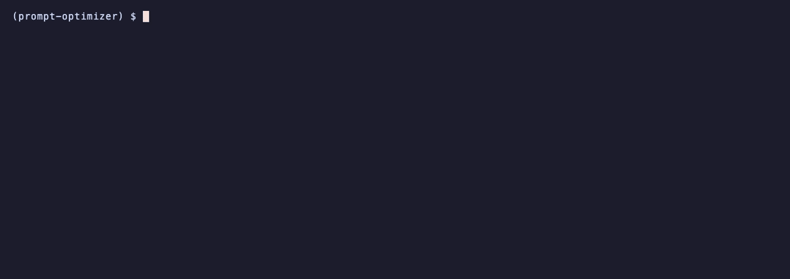
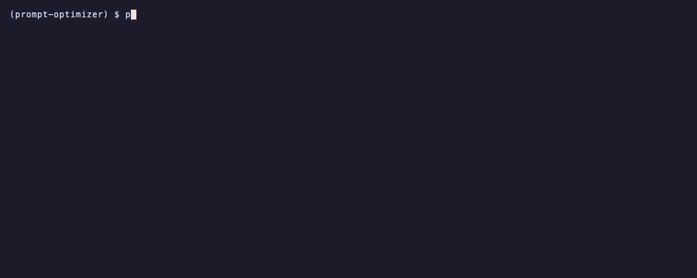
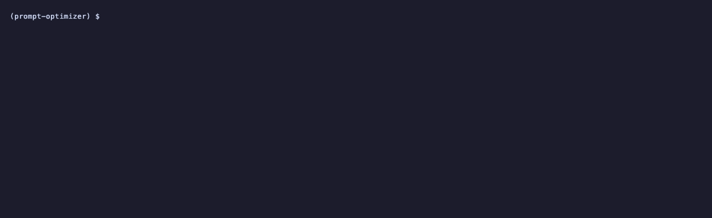
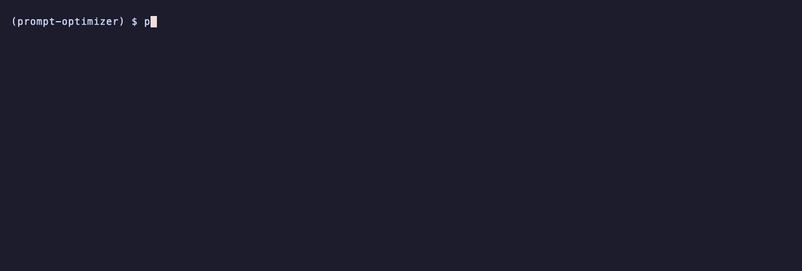
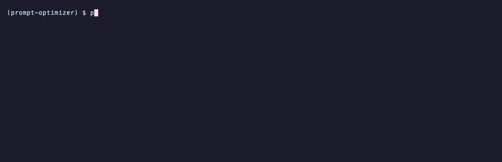

<h1 align="center">Prompt Optimizer</h1>

<p align="center">
  <em>Seven published methods that automatically rewrite the prompt given to an AI model to make it more accurate, built in one code base. They are compared under equal budgets on local Qwen3.5 models and public reasoning benchmarks, with cost counts, confidence intervals and a direct comparison with the DSPy library.</em>
</p>

<p align="center">
  <a href="https://github.com/adeoluo/prompt-optimizer/actions/workflows/ci.yml"></a>
  <a href="https://github.com/adeoluo/prompt-optimizer/releases"></a>
  
  <a href="LICENSE"></a>
</p>

---

> **Evidence level: publicly benchmarked.** The methods were tested on two public benchmarks, GSM8K and BIG-Bench Hard, with local Qwen models, and compared with DSPy 3.4.1. Each search used one optimization seed (one fixed setting of the random choices). No one else has reproduced the results, and the project is not used in production. [What the levels mean](https://github.com/adeoluo#evidence-levels).

## Highlights

The wording of a prompt changes how well an AI model answers. This project rewrites prompts
automatically with seven published methods and measures which ones truly help.

- **One method gave a clear gain on math word problems.** On GSM8K, the TextGrad-style
  method raised a small local model from 64.7% to 75.0% correct answers. The p-value is below
  0.001, so the gain is very unlikely to be chance.
- **The project corrects for luck from testing many methods.** Seven methods were compared
  with the starting prompt. After a correction for making seven comparisons, only that one
  gain still counts as significant, and the Results section reports it that way.
- **The comparison includes DSPy, a widely used prompt-optimization library.** DSPy 3.4.1
  ran on the same model, data and test problems, and its cost was counted the same way. One
  of three direct comparisons shows a significant difference.
- **Every model call is cached.** Each answer is saved on disk, so the whole comparison can
  be scored again from the saved answers.

**Where it falls short:** on a second, broader benchmark, BIG-Bench Hard, no method beat the
starting prompt. The one significant DSPy comparison favors DSPy: its MIPROv2 scored 69.7%,
compared with 64.0% for this repository's MIPROv2-style version. Only one small model
(Qwen3.5-2B) was used for the search.

## Key terms

Plain definitions of the terms used in this README.

| Term | Meaning |
|---|---|
| Accuracy (Val acc, Test acc) | The share of questions answered correctly, in percent, from 0 to 100. Higher is better. Val acc is measured on the validation split, Test acc on the test split. |
| APE | Automatic Prompt Engineer (Zhou et al., 2022). The model reads input and output examples and guesses the instruction behind them. The best-scoring guesses are kept. |
| BIG-Bench Hard (BBH) | A public benchmark of 27 hard reasoning tasks, such as logical deduction, date arithmetic and word sorting. Here one shared prompt serves all 27 tasks. |
| Bootstrapped few-shot | A method that runs the starting prompt on training questions, keeps correct answers as worked examples, and picks the best set of them by random search. |
| Confidence interval (95% CI) | The range in square brackets, such as [59.3, 70.0]. It shows how far a score could move with a different sample of test questions. Narrower means more certain. |
| Demonstration | A worked example, a question with a correct answer, placed in the prompt. A prompt with demonstrations is few-shot. A prompt without them is zero-shot. |
| DSPy | A widely used Python library for building and optimizing prompts. Version 3.4.1 is the outside comparison point in this README. |
| GEPA | Genetic-Pareto prompt evolution (Agrawal et al., 2025). The model reflects on failures to rewrite the instruction. A pool keeps every candidate that is best on at least one question. |
| GSM8K | Grade School Math 8K (Cobbe et al., 2021), a public benchmark of math word problems. An answer is correct when its final number matches exactly. |
| Holm correction | A rule for judging several comparisons at once. It makes the p-value bar stricter, so the chance of any false win among them stays at 5% or less. |
| llama.cpp | An open-source program that runs language models on an ordinary computer. Its `llama-server` answers model requests over HTTP. |
| MIPROv2 | Multiprompt Instruction Proposal Optimizer, version 2 (Opsahl-Ong et al., 2024). It searches instructions and demonstrations together, using a Bayesian method that learns which choices score well. |
| OPRO | Optimization by Prompting (Yang et al., 2023). The model reads earlier instructions with their scores and writes a new one meant to score higher. |
| Opt. tokens | Optimization tokens: all text the model read and wrote during one search, counted in tokens (word pieces), in millions (M). Lower means a cheaper search. |
| p-value | How likely a difference this large would be if the method had no real effect, from 0 to 1. Lower is stronger evidence. Below 0.05 is called significant. |
| Paired difference (Diff vs seed) | A method's accuracy minus the seed prompt's accuracy on the same test questions, in percentage points. Positive means the method did better. |
| PromptBreeder | A method (Fernando et al., 2023) that evolves a population of prompts. It also evolves the mutation prompts that tell the model how to change them. |
| Proposer call | A model call that writes, criticizes or changes a prompt, rather than answering a task question. These calls are counted but not capped. |
| Qwen3.5-2B and Qwen3.5-0.8B | Small open language models with about 2 billion and 0.8 billion learned numbers (parameters). Here each number is compressed to about 4 bits, and thinking mode is off. |
| Seed prompt | The starting prompt every method begins from: the task's plain instruction with no demonstrations. It is the baseline in every table. |
| Task rollout | One model answer to one task question with a candidate prompt. Each search may use at most 400. This is the budget shared by all methods. |
| TextGrad | A method (Yuksekgonul et al., 2024) that writes a critique of a prompt from its failures, called a textual gradient, then rewrites the prompt to address it. |
| Train, validation and test splits | Three separate sets of questions. Methods learn from train and choose their final prompt by validation score. Test is used only for the final score. |
| Transfer | Scoring prompts that were optimized for one model (Qwen3.5-2B) on a different model (Qwen3.5-0.8B), without changing them. |
| Truncated | The share of test answers cut off by the length limit before a final answer appeared. These answers count as wrong. Lower is better. |

## Motivation

A prompt has two main parts: the instruction and the in-context examples (demonstrations
shown inside the prompt). Changing them can move accuracy as much as many changes to the
model itself. A growing body of research treats them as settings to optimize against a
score. Published methods include instruction induction by Automatic Prompt Engineer (APE),
where the model infers the instruction from examples, and a large language model (LLM) used
as the optimizer in Optimization by Prompting (OPRO). Others are Bayesian search over
instructions and demonstrations (MIPROv2), textual gradients (TextGrad), and reflective
evolution with Pareto selection (GEPA). Two more are self-referential evolution
(PromptBreeder) and bootstrapped few-shot demonstrations. Each paper reports its method with
different models, budgets and data splits. So it is hard to say which method helps, by how
much, and at what cost.

This project implements all seven methods behind one shared interface. Every method gets the
same seed prompt, the same budget of task rollouts, the same train, validation and test
splits, and the same answer extraction (the code that reads the final answer from the
model's reply). The methods run on real local models through llama.cpp. Qwen3.5-2B is used
for optimization and Qwen3.5-0.8B for transfer. The benchmarks with real-model results are
GSM8K and BIG-Bench Hard. Three more, MATH-500, HotpotQA and IFEval, are implemented and
tested but have no real-model runs yet. For each method the project reports test accuracy
with 95% bootstrap intervals (ranges computed by resampling the test questions many times).
It also reports a paired test against the seed prompt, the gap between validation and test
scores, and the cost of each search in model calls and tokens. DSPy 3.4.1 is run on the same
model, splits and budget for comparison. The original from-scratch optimizers on a simulated
model remain as a small, deterministic reference that gives the same result on every run.

## Architecture

<p align="center">
  
</p>

<sub>Legend: amber = entry points and external systems, indigo = core logic, green = data and state, blue = validation and control, grey = observability and outputs.</sub>

The experiment runner, or the command-line interface (CLI), loads a benchmark with fixed
splits chosen by a random seed (a fixed number that makes random choices repeatable). It hands an optimizer the seed program, the training and validation
examples and a rollout budget. Here a program means a prompt: an instruction plus optional
demonstrations. Every optimizer works through one `OptimizerContext`. This object scores
candidate programs in batches and remembers each (program, example) score, so no pair is
scored twice. It refuses any batch that would go over the budget, and it labels proposer
calls for cost accounting. All model calls go through `CachedLM`. This is a SQLite cache (a
single-file database) keyed by a hash of each request's content. It sits in front of an
asynchronous client that sends each batch to `llama-server` concurrently. The server's
continuous batching processes the in-flight requests together. The selected program is
scored on the first part of the test split, taken in a fixed random order. Per-example records
feed the bootstrap statistics, the validation-to-test comparison and the results tables.
DSPy runs through the same cached client, so its calls and tokens are counted in the same
way. More detail is in [docs/ARCHITECTURE.md](docs/ARCHITECTURE.md).

### Optimizers

The table lists each method with its paper, the part of the prompt it changes, how this
repository implements it, and its source file. The suffix "-style" marks a re-implementation
that follows the paper's main loop at a smaller scale. TPE (tree-structured Parzen estimator)
is a Bayesian search method that picks choices seen more often in the best earlier trials
than in the rest. A Pareto pool keeps every candidate that is best on at least one example.

| Method | Paper | What it searches | Mechanism in this repository | Module |
|---|---|---|---|---|
| Bootstrapped few-shot | Khattab et al., 2023 (DSPy) | demonstrations | teacher traces kept when correct; random search over demo sets on validation | `optim/bootstrap.py` |
| APE | Zhou et al., 2022 | instruction | induction from input/output pairs, shared-minibatch scoring, paraphrase resampling | `optim/ape.py` |
| OPRO | Yang et al., 2023 | instruction | meta-prompt with the scored trajectory in ascending order, several samples per step | `optim/opro.py` |
| MIPROv2-style | Opsahl-Ong et al., 2024 | instruction and demos jointly | grounded proposals, from-scratch categorical TPE over (instruction, demo set) on validation minibatches | `optim/mipro.py`, `optim/tpe.py` |
| TextGrad-style | Yuksekgonul et al., 2024 | instruction | textual gradient from failures with feedback, momentum, validation-gated step | `optim/textgrad.py` |
| GEPA-style | Agrawal et al., 2025 | instruction | reflective mutation on 3-example minibatches, per-instance Pareto pool and parent sampling | `optim/gepa.py`, `optim/pareto.py` |
| PromptBreeder-style | Fernando et al., 2023 | instruction and mutation prompt | binary tournament; zero and first order, EDA, lineage, hypermutation, Lamarckian and crossover operators | `optim/promptbreeder.py` |

Each module's docstring (the description at the top of the file) states the method's loop.
The GEPA-style and PromptBreeder-style docstrings also state what was replaced or left out
compared with the paper ([ADR-0008](docs/adr/0008-one-optimizer-contract.md)).

## Results

Every number in this section comes from a real run of Qwen3.5-2B, except the transfer
scores on Qwen3.5-0.8B and the simulated-model reference pipeline at the end. The model ran on
llama.cpp from a Q4_K_M GGUF file published by Unsloth, a format that compresses the model to
about 4 bits per number. Thinking mode, where the model writes out its reasoning before
answering, was off. Task answers used greedy decoding, so the model always picked its most
likely next token. All runs shared one Apple M1 computer with 8 GB of memory. All eight rows, the seed
prompt and the seven methods, start from the same seed prompt. Each gets the same budget of
400 task rollouts on the same training and validation splits. Each uses one optimization seed
(0) and never sees the test split.

Intervals are 95% percentile bootstrap intervals over test examples. Differences and p-values
come from a paired bootstrap against the seed prompt on the same examples. Paired means both
prompts are scored on the same questions, which removes the effect of question difficulty.
Each table is regenerated from the committed per-example files in `benchmarks/results/` by
`python -m prompt_optimizer report`. Rerunning the experiments replays every model call
from the response cache (commands under [Experiments](#experiments)).

On GSM8K with Qwen3.5-2B, TextGrad-style search raises test accuracy from 64.7% (seed
prompt) to 75.0%. The paired difference is +10.3 percentage points, with a 95% interval of
[4.7, 16.0] and a p-value below 0.001. The search used 399 task rollouts and 0.13M tokens.
It is the only method whose gain survives a correction for the seven comparisons. OPRO
(+6.0), GEPA-style (+5.3) and PromptBreeder-style (+5.0) gain about half as much.
MIPROv2-style tied for the best validation score, yet it scores below the seed prompt on
test. On BIG-Bench Hard, where one prompt serves 27 tasks, no method beats the seed prompt.

### GSM8K, Qwen3.5-2B (300 test problems)

This table compares the seed prompt and the seven methods on 300 GSM8K test problems. Each
row is one method. The columns give validation and test accuracy, the paired difference from
the seed prompt with its p-value, the share of truncated answers, and the cost of the search.
Higher accuracy and difference are better. Lower p-values, truncation and cost are better.

| Method | Val acc | Test acc [95% CI] | Diff vs seed [95% CI] | p | Truncated | Task rollouts | Proposer calls | Opt. tokens |
|---|---:|---:|---:|---:|---:|---:|---:|---:|
| Seed prompt (zero-shot) | 76.7 | 64.7 [59.3, 70.0] |  |  | 1.3% | 60 | 0 | 0.01M |
| Bootstrapped few-shot (random search) | 81.7 | 68.0 [62.7, 73.3] | 3.3 [-2.3, 9.0] | 0.274 | 1.7% | 400 | 0 | 0.27M |
| APE | 81.7 | 65.0 [59.7, 70.3] | 0.3 [-5.3, 6.0] | 0.945 | 1.3% | 388 | 12 | 0.13M |
| OPRO | 83.3 | 70.7 [65.3, 75.7] | 6.0 [1.0, 11.0] | 0.019 | 1.0% | 390 | 18 | 0.16M |
| MIPROv2-style | 86.7 | 64.0 [58.7, 69.3] | -0.7 [-6.0, 4.7] | 0.839 | 0.0% | 320 | 6 | 0.15M |
| TextGrad-style | 86.7 | 75.0 [69.7, 79.7] | 10.3 [4.7, 16.0] | 0.000 | 3.0% | 399 | 10 | 0.13M |
| GEPA-style | 85.0 | 70.0 [64.7, 75.0] | 5.3 [-0.3, 11.0] | 0.072 | 1.3% | 356 | 20 | 0.18M |
| PromptBreeder-style | 86.7 | 69.7 [64.3, 74.7] | 5.0 [-0.3, 10.3] | 0.088 | 4.7% | 348 | 19 | 0.14M |

Test examples: 300 shared by every row (of 1319 available). Accuracy in percent; intervals are 95% percentile bootstrap over examples (10,000 resamples); differences and p-values are paired bootstrap against the seed prompt on the same examples. Truncated is the share of test answers cut off by the task's max_tokens (scored wrong when no final answer was reached).

TextGrad-style search is the only method whose gain survives a Holm correction for the
seven comparisons with the seed prompt. The correction keeps the chance of any false win
across all seven at 5% or less (family-wise 5%). TextGrad-style scores 75.0% against 64.7%, a
paired difference of +10.3 points [4.7, 16.0], with a p-value below 0.001. OPRO (+6.0,
p = 0.019) is significant on its own but not after the correction. GEPA-style (+5.3,
p = 0.07) and PromptBreeder-style (+5.0, p = 0.09) are borderline. Bootstrapped few-shot
(+3.3) and APE (+0.3) are within noise. MIPROv2-style tied for the best validation score and
scored below the seed prompt on test.

The four programs with the largest gains, from TextGrad-style, OPRO, GEPA-style and
PromptBreeder-style, are all instructions without demonstrations. TextGrad-style rewrote the
instruction, using critiques of failed examples, into an ordering rule: "perform all
arithmetic operations first ... state the scenario logic only after all calculations are
complete". The rewrite step's `<solution>` wrapper stayed in the instruction word for word,
and the model ignores it. OPRO converged on restating the required answer format step by
step. GEPA-style and PromptBreeder-style converged on longer lists of roles and rules.
Demonstrations did not help here. The two programs that use them, bootstrapped few-shot with
two and MIPROv2-style with one, are not significantly better than the seed prompt.

### BIG-Bench Hard, Qwen3.5-2B (27 tasks, 270 test examples)

This table has the same rows and columns as the GSM8K table, for 270 BIG-Bench Hard test
examples, 10 from each of the 27 tasks. Higher accuracy and difference are better.

| Method | Val acc | Test acc [95% CI] | Diff vs seed [95% CI] | p | Truncated | Task rollouts | Proposer calls | Opt. tokens |
|---|---:|---:|---:|---:|---:|---:|---:|---:|
| Seed prompt (zero-shot) | 61.1 | 49.6 [43.7, 55.6] |  |  | 6.7% | 54 | 0 | 0.02M |
| Bootstrapped few-shot (random search) | 61.1 | 49.6 [43.7, 55.6] | 0.0 [0.0, 0.0] | 1.000 | 6.7% | 378 | 0 | 0.18M |
| APE | 61.1 | 49.6 [43.7, 55.6] | 0.0 [0.0, 0.0] | 1.000 | 6.7% | 316 | 12 | 0.14M |
| OPRO | 61.1 | 49.6 [43.7, 55.6] | 0.0 [0.0, 0.0] | 1.000 | 6.7% | 333 | 21 | 0.19M |
| MIPROv2-style | 61.1 | 49.6 [43.7, 55.6] | 0.0 [0.0, 0.0] | 1.000 | 6.7% | 274 | 6 | 0.14M |
| TextGrad-style | 64.8 | 51.1 [45.2, 57.0] | 1.5 [-4.1, 7.0] | 0.653 | 7.0% | 392 | 14 | 0.18M |
| GEPA-style | 61.1 | 49.6 [43.7, 55.6] | 0.0 [0.0, 0.0] | 1.000 | 6.7% | 398 | 22 | 0.24M |
| PromptBreeder-style | 61.1 | 49.6 [43.7, 55.6] | 0.0 [0.0, 0.0] | 1.000 | 6.7% | 258 | 14 | 0.16M |

Test examples: 270 shared by every row (of 405 available). Accuracy in percent; intervals are 95% percentile bootstrap over examples (10,000 resamples); differences and p-values are paired bootstrap against the seed prompt on the same examples. Truncated is the share of test answers cut off by the task's max_tokens (scored wrong when no final answer was reached).

One instruction is shared by all 27 tasks. The tasks mix logical deduction, date arithmetic,
word sorting and boolean evaluation. The seed instruction ("Answer the question.") relies on
each example's own description of its task. Six of the seven methods found no candidate that
beat the seed on the 54-example validation set, so they returned it unchanged. Their test
rows therefore equal the seed's. Their searches did run. GEPA-style accepted four candidates
on three-example minibatches (small random subsets), with scores up to 1.0. Those candidates
then scored 38.9 to 57.4 on the full validation set. MIPROv2-style's best minibatch trial
scored 75.0 on 20 examples and then 51.9 on the full validation set. TextGrad-style's
selected program is the seed instruction wrapped in `<system_prompt>` tags. It gained 3.7
points on validation and 1.5 on test (p = 0.65), which is noise. Per-task prompts, the usual
setup for BIG-Bench Hard, are on the roadmap.

### Against DSPy 3.4.1 on GSM8K

This table compares three methods as implemented here and in DSPy 3.4.1, on the same 300
GSM8K test problems. Each pair of rows is one method: this repository's version, then DSPy's.
The difference columns show each version's gain over its own zero-shot program and the
in-repo score minus the DSPy score. Higher accuracy is better. A negative in-repo minus DSPy
value means DSPy scored higher.

| Method | Implementation | Test acc [95% CI] | Diff vs own zero-shot [95% CI] | In-repo minus DSPy [95% CI] | p | Task rollouts | Proposer calls | Opt. tokens |
|---|---|---:|---:|---:|---:|---:|---:|---:|
| Zero-shot | Seed prompt (zero-shot) (this repository) | 64.7 [59.3, 70.0] |  |  |  | 60 | 0 | 0.01M |
| Zero-shot | DSPy ChainOfThought (zero-shot) (dspy 3.4.1) | 67.0 [61.7, 72.3] |  | -2.3 [-7.3, 2.7] | 0.406 | 60 | 0 | 0.02M |
| Bootstrapped few-shot | Bootstrapped few-shot (random search) (this repository) | 68.0 [62.7, 73.3] | 3.3 [-2.3, 9.0] |  |  | 400 | 0 | 0.27M |
| Bootstrapped few-shot | DSPy BootstrapFewShotWithRandomSearch (dspy 3.4.1) | 69.7 [64.3, 74.7] | 2.7 [-2.7, 8.0] | -1.7 [-7.0, 3.7] | 0.559 | 440 | 0 | 0.41M |
| MIPROv2 | MIPROv2-style (this repository) | 64.0 [58.7, 69.3] | -0.7 [-6.0, 4.7] |  |  | 320 | 6 | 0.15M |
| MIPROv2 | DSPy MIPROv2 (dspy 3.4.1) | 69.7 [64.3, 74.7] | 2.7 [-2.3, 7.7] | -5.7 [-11.0, -0.3] | 0.046 | 499 | 29 | 0.45M |

Test examples: 300 shared by every row. Accuracy in percent with 95% bootstrap intervals; the gain column is paired against the same implementation's zero-shot program, the head-to-head column is paired in-repo minus DSPy.

DSPy 3.4.1 ran on the same model, server, splits and test prefix. It used this repository's
cached and metered client, so calls and tokens are counted the same way. DSPy formats prompts
differently, with field markers and a separate reasoning field. So each implementation is
compared with its own zero-shot program as well as directly with the other. DSPy's zero-shot
ChainOfThought (a prompt that asks for reasoning before the answer) scores 67.0, compared
with 64.7 for the in-repo seed prompt. DSPy's BootstrapFewShotWithRandomSearch scores 69.7,
compared with 68.0 for the in-repo bootstrapped few-shot. Neither difference is significant
(p = 0.41 and 0.56). DSPy's random search has no rollout cap. With three candidate programs
it used 440 task rollouts, 10% more than the in-repo methods' budget.

DSPy's MIPROv2 also has no hard cap: its number of trials and its minibatch size set the
cost. It used 499 task rollouts, 29 proposer calls and 0.45M tokens. The in-repo
MIPROv2-style run used 320 rollouts, 6 proposer calls and 0.15M tokens. DSPy's MIPROv2
scores 69.7, which is 5.7 points [0.3, 11.0] above the in-repo MIPROv2-style program
(p = 0.046). This is the one significant direct difference. It is also 2.7 points
[-2.3, 7.7] above DSPy's own zero-shot program. Both MIPROv2 runs scored well on validation
(83.3 and 86.7). The in-repo run lost more of that score on test (22.7 points, compared with
13.6). So with these budgets, DSPy's longer search selected a program that generalized
better to new questions.

### Transfer to Qwen3.5-0.8B

These tables take the programs optimized on Qwen3.5-2B and score them unchanged with the
smaller Qwen3.5-0.8B on the same test examples. Each row is one program. Each column is the
model that answered, and each cell is test accuracy in percent with its 95% interval. Higher
is better. The paired differences in the text below are against the seed prompt on 0.8B.

GSM8K (300 problems):

| Method | qwen3.5-0.8b | qwen3.5-2b |
|---|---:|---:|
| Seed prompt (zero-shot) | 40.3 [34.7, 46.0] | 64.7 [59.3, 70.0] |
| MIPROv2-style | 33.3 [28.0, 38.7] | 64.0 [58.7, 69.3] |
| TextGrad-style | 45.0 [39.3, 50.7] | 75.0 [69.7, 79.7] |
| PromptBreeder-style | 44.7 [39.0, 50.0] | 69.7 [64.3, 74.7] |

Programs optimized on qwen3.5-2b. Shared test examples per model: qwen3.5-0.8b: 300, qwen3.5-2b: 300.

BIG-Bench Hard (270 examples):

| Method | qwen3.5-0.8b | qwen3.5-2b |
|---|---:|---:|
| Seed prompt (zero-shot) | 36.3 [30.7, 42.2] | 49.6 [43.7, 55.6] |
| TextGrad-style | 34.4 [28.9, 40.0] | 51.1 [45.2, 57.0] |

Programs optimized on qwen3.5-2b. Shared test examples per model: qwen3.5-0.8b: 270, qwen3.5-2b: 270.

The two instruction rewrites that helped on 2B also help on 0.8B, by about half as much,
and no longer significantly. TextGrad-style gains +4.7 points [-1.0, 10.3] (p = 0.12) and
PromptBreeder-style +4.3 [-1.3, 10.0] (p = 0.16). MIPROv2-style's program was level with the
seed prompt on 2B, but it hurts on 0.8B: -7.0 points [-13.0, -0.7] (p = 0.03). On BIG-Bench
Hard, TextGrad-style's 2B gain does not carry over (-1.9 points, p = 0.57).

### Cost of the search

Task rollouts are capped at 400 per run and counted before every batch. Proposer calls
(instruction proposals, critiques, reflections, mutations) are counted but not capped. They
are cheap compared with the rollouts: 0 to 22 calls per run. Optimization tokens range from
0.13M to 0.27M per run. On GSM8K, bootstrapped few-shot is the most expensive (0.27M),
because its candidate programs carry demonstrations into every rollout. TextGrad-style, the
best method there, is among the cheapest (0.13M). On BIG-Bench Hard, GEPA-style is the most
expensive (0.24M). Each run took 10 to 67 minutes of wall-clock time on the shared M1. The
model wrote about 45 completion tokens (tokens of output) per second across 8 parallel
requests. Wall-clock time also depends on how many calls were already in the response cache.
So the token counts, not the times, are the fair basis for comparing cost.

### Benchmarks, splits and coverage

This table lists the five benchmarks. For each, it gives the number of examples in the train
and validation splits, the test examples available and scored, and whether real-model results
exist.

| Benchmark | Train | Validation | Test available | Test scored | Real-model results |
|---|---:|---:|---:|---:|---|
| GSM8K | 200 | 60 | 1,319 | 300 (seeded prefix) | yes: eight methods, DSPy, transfer |
| BIG-Bench Hard | 216 | 54 | 405 | 270 (10 per task) | yes: eight methods, transfer |
| MATH-500 | 200 | 100 | 500 |  | not yet (loader, scoring and tests) |
| HotpotQA (distractor) | 150 | 100 | 500 |  | not yet (loader, scoring and tests) |
| IFEval | 100 | 100 | 341 |  | not yet (loader, 25 checkers and tests) |

MATH-500 (competition math problems), HotpotQA in its distractor setting (questions that need
facts from two Wikipedia paragraphs, mixed with unrelated ones) and IFEval (prompts with
instructions whose results a program can check) are implemented end to end. This covers
download with checksums, seeded splits, answer extraction, scoring, the 25 IFEval instruction
checkers and feedback to the proposer. Offline tests cover them, and every optimizer runs on
them with `--task math500`, `--task hotpotqa` or `--task ifeval`. They have no real-model
results in this release. On the shared M1, the GSM8K and BIG-Bench Hard comparisons used the
compute budget, and the README reports only what was run.

### Reference pipeline (simulated model)

The original from-scratch optimizers run on a deterministic simulated model and a
three-class intent task: sorting customer messages into refund, shipping or cancel. They
remain as a small, offline reference (`python -m prompt_optimizer evaluate`). The table shows
test accuracy, from 0 to 1 (higher is better), and the number of demonstrations in each
selected prompt.

| Method | Demonstrations | Test accuracy |
|---|---:|---:|
| Baseline (naive, zero-shot) | 0 | 0.333 |
| Instruction search | 0 | 0.833 |
| Few-shot bootstrap | 3 | 0.833 |
| Compound (instruction plus few-shot) | 1 | 1.000 |

On six test messages, instruction search and few-shot search each raise accuracy on their
own, and the compound optimizer reaches 1.000. Its scaling run (600 synthetic tasks, mean
improvement +0.59) and the service's response times are in
[docs/SCALING.md](docs/SCALING.md) and [docs/OPERATIONS.md](docs/OPERATIONS.md).

## Quickstart

```bash
git clone https://github.com/adeoluo/prompt-optimizer.git && cd prompt-optimizer
make setup                     # uv sync plus pre-commit hooks
make all                       # lint, type-check, tests with the coverage gate

# offline: any optimizer against the deterministic fake model
python -m prompt_optimizer optimizers
python -m prompt_optimizer optimize --fake --optimizer gepa --budget 300

# real model: download the benchmarks and start llama.cpp with Qwen3.5-2B
uv run --with pyarrow python scripts/download_data.py
llama-server -hf unsloth/Qwen3.5-2B-GGUF:Q4_K_M --port 8091 -np 8 -c 16384 -kvu \
    --reasoning off -fa on -ctk q8_0 -ctv q8_0 --cache-ram 0
python -m prompt_optimizer optimize --task gsm8k --optimizer gepa --budget 400
```

## Usage

### CLI

| Command | What it does |
|---|---|
| `python -m prompt_optimizer optimizers` | list the optimizers with their papers |
| `python -m prompt_optimizer optimize --task T --optimizer O --budget N [--fake] [--set key=value]` | run one optimizer and print the validation trajectory, the selected prompt and its cost |
| `python -m prompt_optimizer report` | render every results table from `benchmarks/results/` |
| `python -m prompt_optimizer evaluate`, `compile`, `predict`, `serve` | the reference pipeline on the simulated model |

### Library

```python
from prompt_optimizer.backends import CachedLM, LlamaCppLM, ResponseCache
from prompt_optimizer.optim import Budget, build
from prompt_optimizer.tasks.registry import load_task

task, splits = load_task("gsm8k")
lm = CachedLM(LlamaCppLM("http://127.0.0.1:8091", "qwen3.5-2b"), ResponseCache("lm.sqlite"))
result = build("gepa").compile(task, lm, splits.train, splits.val, budget=Budget(400), seed=0)
print(result.val_score, result.program.instruction, result.rollouts_used)
```

Any object with a `model_id` and a `generate(requests) -> responses` method can serve as the
model (`backends/base.py`). `FakeLM` is the deterministic stand-in model used in tests.

### Experiments

```bash
# optimize and score on test (resumable; every call is cached); BBH uses --test-limit 270
python benchmarks/run_experiments.py --task gsm8k --budget 400 --test-limit 300 \
    --optimizers seed bootstrap_fewshot ape opro miprov2 textgrad gepa promptbreeder
# transfer: score the 2B-optimized programs on another model (the script swaps servers)
python benchmarks/run_experiments.py --task gsm8k --optimizers seed textgrad miprov2 promptbreeder \
    --eval-model qwen3.5-0.8b --test-limit 300 --transfer-only
# DSPy 3.4.1 on the same model, splits and budget
uv run --group compare python benchmarks/dspy_compare.py --task gsm8k --budget 400 \
    --test-limit 300 --optimizers seed bootstrap_rs miprov2
python -m prompt_optimizer report
```

### HTTP service

The reference pipeline also includes an HTTP service (`serve`) built only on Python's
standard library. It offers the endpoints `/predict`, `/compile`, `/health`, `/ready` and
`/metrics`. Details are in [docs/OPERATIONS.md](docs/OPERATIONS.md).

### Demos

The animations below were recorded from real runs with [vhs](https://github.com/charmbracelet/vhs), a tool that records terminal sessions. Each recording script (tape) is in `docs/demo/`.

The list of seven optimizers, then a GEPA-style search with the deterministic fake model. No model server is needed.

<p align="center">
  
</p>

A finished Qwen3.5-2B GEPA-style run on GSM8K, replayed from the response cache. Every model call is answered from disk, so the accepted candidates and the selected prompt are the ones from the recorded run.

<p align="center">
  
</p>

The results tables, built from the committed per-example files. They show test accuracy with bootstrap intervals, paired differences against the seed prompt and the cost of each search.

<p align="center">
  
</p>

The reference pipeline on the simulated model. It builds (compiles) a prompt by search, then makes a prediction with it.

<p align="center">
  
</p>

The reference ablation, a test that compares the compiled prompt with the naive starting prompt.

<p align="center">
  
</p>

The reference HTTP service predicting with the compiled prompt.

<p align="center">
  
</p>

## Design decisions

Each decision links to its architecture decision record (ADR), a short document that explains
the choice.

- **Real models through llama.cpp, with thinking mode off and requests batched.** ([ADR-0004](docs/adr/0004-local-models-through-llama-cpp.md))
- **The task, not the method, sets the required answer format.** So methods differ in reasoning, not in how often their answers can be read. ([ADR-0005](docs/adr/0005-fixed-output-contract.md))
- **A cache keyed by a hash of each request, written after every response.** Replays are free, interrupted runs can resume, and the cost columns stay identical on a rerun. ([ADR-0006](docs/adr/0006-content-hash-cache-and-resumable-runs.md))
- **Equal rollout budgets and strict splits.** No optimizer ever sees the test split. ([ADR-0007](docs/adr/0007-rollout-budget-and-split-discipline.md))
- **Seven optimizers behind one shared interface**, each following its paper's core loop. ([ADR-0008](docs/adr/0008-one-optimizer-contract.md))
- **DSPy runs through the same cached client that counts every call.** ([ADR-0009](docs/adr/0009-dspy-through-the-shared-client.md))
- **Bootstrap intervals and paired differences on shared examples.** ([ADR-0010](docs/adr/0010-paired-bootstrap-statistics.md))
- **A simulated model and metric-driven compilation for the reference pipeline.** ([ADR-0002](docs/adr/0002-simulated-language-model.md), [ADR-0003](docs/adr/0003-metric-driven-compilation.md), [ADR-0001](docs/adr/0001-record-architecture-decisions.md))

## Testing

```bash
make test                      # uv run pytest (offline, deterministic)
make coverage                  # with the coverage gate
uv run --group compare pytest tests/test_dspy_adapter.py   # DSPy adapter, needs dspy
```

The test suite has 299 offline, deterministic tests. Two of them check the DSPy adapter and
run only when DSPy is installed. The tests cover 97% of the code in `src/`, and continuous
integration (CI, the automatic checks on every change) requires at least 80%. All tests run
against `FakeLM`, a deterministic stand-in model. Its accuracy rises with better
instructions and correct demonstrations, so every optimizer has a real signal to find.
Several tests use Hypothesis (a library that generates many random test inputs) to check
properties:

- **Optimizer contract** (`test_optim.py`): for each of the seven optimizers, the tests check
  improvement over the seed, the rollout budget, the same result for the same seed, selection
  of the best validation score, a seed-only result on a tiny budget, and that no test example
  ever reaches the model. Method-specific checks cover OPRO's history order and size limit,
  MIPROv2's TPE trials and grounded proposals, and TextGrad's gradient and step prompts. They
  also cover GEPA's reflection and crossover, each of PromptBreeder's six mutation operators,
  and bootstrapped traces that are correct and not truncated.
- **Search components:** for TPE, the tests check random choices at the start and then a
  preference for high scorers, smoothed probability estimates, and that suggestions stay
  inside the search space (with Hypothesis). For Pareto selection, they check the fronts
  (groups of candidates that no other candidate beats everywhere), removal of beaten
  candidates, proportional sampling, and that every front is covered (with Hypothesis).
  Sampling of demonstration sets per group is also tested.
- **Statistics and runner** (`test_experiments.py`): bootstrap intervals compared with the
  normal approximation, the paired bootstrap, and McNemar's test (an exact test for paired
  right or wrong answers), with symmetry checked under Hypothesis. The tests also cover
  nested test prefixes, resumable run and test files, report tables and the CLI.
- **Backends** (`test_backends.py`): request hashing, the SQLite cache, cache writes after
  each response, retries and permanent errors over a mock HTTP transport, cost accounting,
  and the server command line.
- **Benchmarks** (`test_tasks.py`, `test_ifeval.py`): loaders, seeded splits that do not
  overlap, answer extraction and scoring for GSM8K, BIG-Bench Hard, MATH-500 and HotpotQA,
  and the IFEval instruction checkers.
- **Reference pipeline** (`test_core.py`, `test_optimizers.py`, `test_evaluation.py`,
  `test_service.py`).

Optional test suites: `uv run --group compare pytest tests/test_dspy_adapter.py` checks the
DSPy adapter offline. `pytest -m integration` makes real calls to a running `llama-server`.
CI runs `ruff format --check` and `ruff check` (a Python formatter and code checker),
`mypy --strict src` (a type checker) and the tests on Python 3.12, 3.13, 3.14 and 3.15. It then
builds the wheel and the source distribution (sdist), the two Python package formats, and
the Docker image.

## Responsible AI

- **Model card:** [docs/MODEL_CARD.md](docs/MODEL_CARD.md) (models used and their roles)
- **Data card:** [docs/DATA_CARD.md](docs/DATA_CARD.md) (sources, sizes, licenses, splits, contamination)
- **Threat model:** [docs/THREAT_MODEL.md](docs/THREAT_MODEL.md) (mapped to the OWASP Top 10 for LLM Applications 2026, a standard list of security risks for LLM software from the Open Worldwide Application Security Project)
- **Evaluation report:** [docs/EVALUATION_REPORT.md](docs/EVALUATION_REPORT.md) (method, all results, threats to validity)

## Limitations

- **Scale limited by compute.** Every run used one shared Apple M1 with 8 GB of memory. The
  2B model produced about 50 completion tokens per second in total. So each optimization run
  gets 400 task rollouts, while papers often use thousands. GSM8K is scored on a seeded
  300-problem prefix of its 1,319-problem test split. BIG-Bench Hard is scored on 10 examples
  per task (270 of the 405 held-out examples). The full GSM8K test and the remaining BIG-Bench
  Hard examples are not yet scored.
- **Two of five benchmarks have real-model results.** MATH-500, HotpotQA and IFEval are
  implemented, split and tested (loaders, answer extraction, scoring, the 25 IFEval
  checkers), but they have no real-model runs yet.
- **One optimization seed.** Bootstrap intervals cover the variation from which test examples
  were sampled, not the randomness of the search. A method's rank can change with another
  seed.
- **Small validation sets** (60 and 54 examples) make the choice of the final prompt noisy.
  The validation versus test table in [docs/EVALUATION_REPORT.md](docs/EVALUATION_REPORT.md)
  measures how much validation scores overstate test scores.
- **Small quantized models without thinking mode.** Quantized means compressed to fewer bits
  per weight. Conclusions may not carry over to larger models, full precision or thinking
  mode.
- **Faithful cores, not reproductions.** Each method follows its paper's main loop at a
  smaller scale. GEPA's module-wise merge has no counterpart in a program with one module.
  PromptBreeder evolves one task prompt per unit and no few-shot contexts.
- **Benchmark contamination** cannot be excluded. The public benchmarks are older than the
  models, so their questions may have been in the models' training data.

## Roadmap

- [ ] Real-model runs on MATH-500, HotpotQA and IFEval with the same eight methods
- [ ] Full GSM8K test (1,319) and all 405 held-out BIG-Bench Hard examples for every method, with three optimization seeds
- [ ] Larger budgets (1,000 and 3,000 rollouts) to measure how the ranking changes with more spending
- [ ] Programs with several modules (retrieve, then answer, for HotpotQA), so GEPA's merge and MIPROv2's per-module search apply
- [ ] DSPy GEPA in the direct comparison, and BIG-Bench Hard for the DSPy rows

## License

Released under the [MIT License](LICENSE).
