<h1 align="center">Prompt Optimizer</h1>

<p align="center">
  <em>Automated prompt and few-shot optimization built from scratch: compile a prompt against a metric by searching over instructions and labeled demonstrations.</em>
</p>

<p align="center">
  <a href="https://github.com/adeoluo/prompt-optimizer/actions/workflows/ci.yml"></a>
  
  
  
  
  
</p>

---

## Motivation

Writing prompts by hand is slow and brittle: the instruction wording and the choice of
in-context examples both move accuracy, and tuning them manually does not scale. Prompt
optimization treats the prompt as something you **compile against a metric**, searching over
instructions and demonstrations the way an optimizer searches over parameters. This project
builds that idea **from first principles** - including a deterministic, offline language
model whose output genuinely responds to the prompt, so the search has real signal - with
**zero runtime dependencies** and a reproducible test suite.

## Architecture

<p align="center">
  
</p>

An optimizer draws **demonstrations** from the training set and **instructions** from a
candidate set, scores each candidate on a held-out **validation set**, and emits a
**compiled prompt**. A predictor runs that prompt through the language model, and a metric
closes the loop. See the [ADRs](docs/adr/) for the key design choices.

## The language model

Optimizing a prompt requires a model whose answers depend on the prompt. To stay offline,
deterministic, and dependency-free, this project ships a **simulated language model** that
captures the two behaviours that make prompt optimization work in practice, both generic
(not tuned to the bundled task):

- **In-context learning.** Given demonstrations, it answers by copying the label of the most
  similar demonstration (nearest neighbour over token overlap). Better and more relevant
  demonstrations raise accuracy.
- **Instruction following.** It reads the label vocabulary out of the instruction and snaps
  its answer to the closest valid label; without the vocabulary it must guess from keywords.

## Results

> Reproduce with `python -m prompt_optimizer evaluate`. Exact-match accuracy on a held-out
> test split, starting from a naive zero-shot prompt.

| Method | demonstrations | test accuracy |
|---|---:|---:|
| baseline (naive, zero-shot) | 0 | 0.333 |
| instruction search | 0 | 0.833 |
| few-shot bootstrap | 3 | 0.833 |
| **compound (instruction + few-shot)** | 1 | **1.000** |

Each search dimension lifts accuracy on its own, and the **compound** optimizer - coordinate
ascent that alternates instruction search and demonstration selection - reaches **1.000**,
beating either component. The two dimensions are complementary, which is the central claim.

## Optimizers

- **Bootstrap few-shot** - greedy forward selection of demonstrations against the validation
  metric, with a budget. Finds a small, high-value set of in-context examples.
- **Instruction search** - selects the best instruction from a candidate set.
- **Compound** - coordinate ascent that alternates the two until the score stabilizes.

Each optimizer is deterministic and returns a traced `OptimizationResult`.

## Quickstart

```bash
git clone https://github.com/adeoluo/prompt-optimizer.git && cd prompt-optimizer
make setup                    # install dev tooling + pre-commit hooks
make all                      # lint + type-check + test

python -m prompt_optimizer evaluate                     # four-way ablation
python -m prompt_optimizer compile                      # show the compiled prompt
python -m prompt_optimizer predict "I need a refund for my money"
```

Use the library directly:

```python
from prompt_optimizer import CompoundOptimizer, Predictor, Prompt
from prompt_optimizer.data import CANDIDATE_INSTRUCTIONS, NAIVE_INSTRUCTION, TRAIN, VALIDATION

base = Prompt(NAIVE_INSTRUCTION)
result = CompoundOptimizer(CANDIDATE_INSTRUCTIONS).compile(base, TRAIN, VALIDATION)
print(result.prompt.instruction, len(result.prompt.demonstrations))
print(Predictor(result.prompt).predict("where is my package"))
```

## Components

- **types** - an immutable `Prompt` (instruction plus ordered demonstrations) and `Example`.
- **lm** - the deterministic simulated language model.
- **predictor** - binds a prompt to the model.
- **metrics** - exact match, token F1, and dataset evaluation.
- **optimizers** - bootstrap few-shot, instruction search, and compound.
- **evaluation** - the four-way ablation on held-out data.

## Design decisions

- **A simulated language model.** A deterministic, offline model keeps the whole pipeline
  reproducible and dependency-free while still giving the search a real signal.
  ([ADR-0002](docs/adr/0002-simulated-language-model.md))
- **Compile against a validation metric.** Candidates are scored on held-out data, so the
  compiled prompt is selected for generalization, not training fit.
  ([ADR-0003](docs/adr/0003-metric-driven-compilation.md))

## Performance

A deterministic micro-benchmark (`uv run python benchmarks/benchmark.py`) compiles the task
with each optimizer and reports compile time, validation score, and the number of selected
demonstrations. Each optimizer compiles in under a few milliseconds, since every candidate is
scored on a small held-out split rather than by calling a model.

## Responsible AI

- **Model card:** [docs/MODEL_CARD.md](docs/MODEL_CARD.md)
- **Data card:** [docs/DATA_CARD.md](docs/DATA_CARD.md)
- **Threat model:** [docs/THREAT_MODEL.md](docs/THREAT_MODEL.md)

## Limitations

- The language model is a deterministic simulation; it demonstrates the optimization
  dynamics but is not a substitute for a real model, which would drop in behind the predictor.
- The bundled task is small and illustrative, not a competitive benchmark.
- The instruction candidate set is enumerated; it is not generated or paraphrased.

## Roadmap

- [ ] A model-backed predictor behind the existing interface
- [ ] Instruction generation and paraphrasing rather than a fixed candidate set
- [ ] Additional metrics and a larger, graded task

## License

[MIT](LICENSE). Part of a 28-project artificial intelligence engineering portfolio by
[adeoluo](https://github.com/adeoluo).
