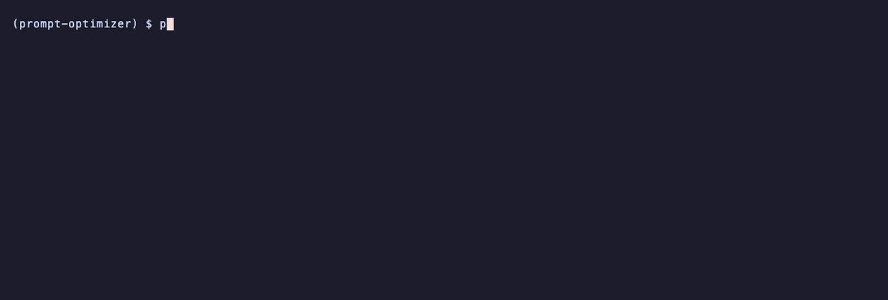
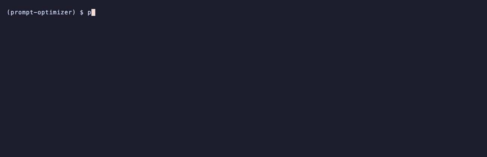

<h1 align="center">Prompt Optimizer</h1>

<p align="center">
  <em>Automated prompt and few-shot optimization built from scratch: compile a prompt against a metric by searching over instructions and labeled demonstrations.</em>
</p>

<p align="center">
  <a href="https://github.com/adeoluo/prompt-optimizer/actions/workflows/ci.yml"></a>
  <a href="https://github.com/adeoluo/prompt-optimizer/releases"></a>
  
  <a href="LICENSE"></a>
</p>

---

## Motivation

Writing prompts by hand is slow and brittle: the instruction wording and the choice of
in-context examples both move accuracy, and tuning them manually does not scale. Prompt
optimization treats the prompt as something you **compile against a metric**, searching over
instructions and demonstrations the way an optimizer searches over parameters. This project
builds that idea **from scratch**, including a deterministic, offline language
model whose output genuinely responds to the prompt, so the search has real signal, with
a reproducible test suite.

## Architecture

<p align="center">
  
</p>

<sub>Legend: amber = entry points and external systems, indigo = core logic, green = data and state, blue = validation and control, grey = observability and outputs.</sub>

The compound optimizer alternates between choosing **instructions** from a candidate set and
selecting **demonstrations** from the training set, scoring every candidate on a held-out
**validation set** by running it through the predictor, and emits a **compiled prompt** with a
trace of the search. The HTTP service compiles once at startup, validates each request, and
answers `/predict` by running the compiled prompt through the simulated language model; the
ablation compares the naive, instruction-only, few-shot, and compound prompts on the test
split. See the [ADRs](docs/adr/) for the key design choices.

### The language model

Optimizing a prompt requires a model whose answers depend on the prompt. To stay offline and
deterministic, this project ships a **simulated language model** that
captures the two behaviours that make prompt optimization work in practice, both generic
(not tuned to the bundled task):

- **In-context learning.** Given demonstrations, it answers by copying the label of the most
  similar demonstration (nearest neighbour over token overlap). Better and more relevant
  demonstrations raise accuracy.
- **Instruction following.** It reads the label vocabulary out of the instruction and snaps
  its answer to the closest valid label; without the vocabulary it must guess from keywords.

### Optimizers

- **Bootstrap few-shot**: greedy forward selection of demonstrations against the validation
  metric, with a budget. Finds a small, high-value set of in-context examples.
- **Instruction search**: selects the best instruction from a candidate set.
- **Compound**: coordinate ascent that alternates the two until the score stabilizes.

Each optimizer is deterministic and returns a traced `OptimizationResult`.

### Components

- **types**: an immutable `Prompt` (instruction plus ordered demonstrations) and `Example`.
- **lm**: the deterministic simulated language model.
- **predictor**: binds a prompt to the model.
- **metrics**: exact match, token F1, and dataset evaluation.
- **optimizers**: bootstrap few-shot, instruction search, and compound.
- **evaluation**: the four-way ablation on held-out data.

## Results

> Reproduce with `python -m prompt_optimizer evaluate`. Exact-match accuracy on a held-out
> test split, starting from a naive zero-shot prompt.

| Method | demonstrations | test accuracy |
|---|---:|---:|
| baseline (naive, zero-shot) | 0 | 0.333 |
| instruction search | 0 | 0.833 |
| few-shot bootstrap | 3 | 0.833 |
| **compound (instruction + few-shot)** | 1 | **1.000** |

Each search dimension lifts accuracy on its own, and the **compound** optimizer (coordinate
ascent that alternates instruction search and demonstration selection) reaches **1.000**,
beating either component. The two dimensions are complementary, which is the central claim.

### Scale

To check that the optimizer holds up across many tasks, `benchmarks/scale.py` runs the
compound optimizer over growing batches of independent synthetic intent-classification
tasks, timing `CompoundOptimizer.compile` and tracking peak memory with the
standard-library `tracemalloc`. The quality metric is the mean held-out improvement: the
optimized prompt's test accuracy minus the naive baseline's. The data is synthetic and the
numbers are environment-specific; because each task is small and discarded, the optimizer
is compute-bound, so memory stays small while time scales with the batch.

| Prompts optimized | Wall-clock (s) | Throughput (prompts/s) | Peak memory (MiB) | Mean improvement |
|---:|---:|---:|---:|---:|
| 100 | 3.23 | ~31 | 0.04 | +0.572 |
| 200 | 4.09 | ~49 | 0.06 | +0.598 |
| 400 | 11.02 | ~36 | 0.11 | +0.596 |
| 600 | 19.50 | ~31 | 0.17 | +0.588 |

The mean improvement holds near +0.59 as the batch grows, matching the single-task result:
the compound optimizer reliably lifts a naive prompt well above its baseline. The headline
quality numbers come from the deterministic offline simulator; a production deployment
would swap in a real language-model API. Reproduce with `uv run python benchmarks/scale.py`.

### Performance and reliability

A deterministic micro-benchmark (`uv run python benchmarks/benchmark.py`) compiles the task
with each optimizer and reports compile time, validation score, and the number of selected
demonstrations. Each optimizer compiles in under a few milliseconds, since every candidate is
scored on a small held-out split rather than by calling a model.

A production-style stress benchmark (`uv run python benchmarks/stress.py`) drives the full
predict handler under concurrent load and reports throughput with p50, p95, and p99 latency.
It shows the project's distinctive cost shape: compilation is a one-time startup cost, and
each prediction is a nearest-neighbour lookup serving on the order of 100000 requests per
second per core. The scaling path and tradeoffs are in [docs/SCALING.md](docs/SCALING.md),
and a full compile-and-serve walk-through is in the [case study](docs/CASE_STUDY.md).

## Quickstart

```bash
git clone https://github.com/adeoluo/prompt-optimizer.git && cd prompt-optimizer
make setup                    # install dev tooling + pre-commit hooks
make all                      # lint + type-check + test

python -m prompt_optimizer evaluate                     # four-way ablation
python -m prompt_optimizer compile                      # show the compiled prompt
python -m prompt_optimizer predict "I need a refund for my money"
```

## Usage

### Library

```python
from prompt_optimizer import CompoundOptimizer, Predictor, Prompt
from prompt_optimizer.data import CANDIDATE_INSTRUCTIONS, NAIVE_INSTRUCTION, TRAIN, VALIDATION

base = Prompt(NAIVE_INSTRUCTION)
result = CompoundOptimizer(CANDIDATE_INSTRUCTIONS).compile(base, TRAIN, VALIDATION)
print(result.prompt.instruction, len(result.prompt.demonstrations))
print(Predictor(result.prompt).predict("where is my package"))
```

### HTTP service

A standard-library HTTP service compiles the prompt once at startup and serves predictions:

```bash
python -m prompt_optimizer serve --port 8000

curl localhost:8000/health
curl -s -X POST localhost:8000/predict -d '{"text": "I need a refund for my money"}'
curl -s -X POST localhost:8000/compile
```

`GET /health` reports the compiled instruction and demonstration count; `POST /predict`
returns a label; `POST /compile` returns the full compiled prompt for inspection. The service
also exposes `GET /ready` (readiness) and `GET /metrics` (per-route request, error, and latency
metrics in Prometheus text format). See the [operations guide](docs/OPERATIONS.md) for the
service contract and operational constraints.

### Demos

Recorded from real runs with [vhs](https://github.com/charmbracelet/vhs); each tape is in `docs/demo/`.

Compiling a prompt by search, then a prediction with it.

<p align="center">
  
</p>

The optimized prompt against the baseline.

<p align="center">
  
</p>

The HTTP service predicting with the compiled prompt.

<p align="center">
  
</p>

## Design decisions

- **A simulated language model.** A deterministic, offline model keeps the whole pipeline
  reproducible and credential-free while still giving the search a real signal.
  ([ADR-0002](docs/adr/0002-simulated-language-model.md))
- **Compile against a validation metric.** Candidates are scored on held-out data, so the
  compiled prompt is selected for generalization, not training fit.
  ([ADR-0003](docs/adr/0003-metric-driven-compilation.md))
- **Recording decisions.** ([ADR-0001](docs/adr/0001-record-architecture-decisions.md))

## Testing

```bash
make test                     # uv run pytest
make coverage                 # pytest with an 80% coverage gate
```

The suite has 33 deterministic, offline tests in four modules under `tests/`:

- **Core** (`test_core.py`): `Example` and `Prompt` validation and immutability, prompt
  rendering, tokenization, Jaccard bounds, exact match and token F1, label parsing, and the
  simulated model's nearest-demonstration copying, keyword fallback, and snapping to the label
  vocabulary.
- **Optimizers** (`test_optimizers.py`): bootstrap improves over zero-shot and respects its
  budget, instruction search prefers the vocabulary instruction, the compound optimizer beats
  each component, and invalid budgets, rounds, and candidate sets are rejected.
- **Evaluation and CLI** (`test_evaluation.py`): the compound optimizer is best in the
  ablation, each optimizer at least matches the baseline, and the `evaluate`, `compile`, and
  `predict` commands.
- **HTTP service** (`test_service.py`): health, readiness, `/predict` (including missing and
  overlong text), `/compile`, unknown routes, and request metrics.

CI (`.github/workflows/ci.yml`) runs `ruff format --check`, `ruff check`, `mypy src`, and
`pytest` with an 80% coverage gate on Python 3.12, 3.13, 3.14 and 3.15, then builds the package and the
Docker image.

## Responsible AI

- **Model card:** [docs/MODEL_CARD.md](docs/MODEL_CARD.md)
- **Data card:** [docs/DATA_CARD.md](docs/DATA_CARD.md)
- **Threat model:** [docs/THREAT_MODEL.md](docs/THREAT_MODEL.md)

## Limitations

- The language model is a deterministic simulation; it demonstrates the optimization
  dynamics but is not a substitute for a real model, which would drop in behind the predictor.
- The bundled task is small and illustrative, not a competitive benchmark.
- The instruction candidate set is enumerated; it is not generated or paraphrased.

## Roadmap

- [ ] A model-backed predictor behind the existing interface
- [ ] Instruction generation and paraphrasing rather than a fixed candidate set
- [ ] Additional metrics and a larger, graded task

## License

Released under the [MIT License](LICENSE).
