# Architecture: Prompt Optimizer

  

## Package layout

| Path | Role |
|---|---|
| `src/prompt_optimizer/program.py` | `PromptProgram` (instruction plus demonstrations) and `Demo`; rendering to chat messages; per-group demos; content fingerprint |
| `src/prompt_optimizer/tasks/` | `Task` contract (output contract, extraction, scoring, feedback); GSM8K, BIG-Bench Hard, MATH-500, HotpotQA, IFEval loaders; seeded splits (`registry.py`); the synthetic arithmetic task for tests |
| `src/prompt_optimizer/backends/` | `LMRequest`/`LMResponse` and the `LanguageModel` protocol; `LlamaCppLM` async client and `LlamaServer` process manager; `ResponseCache` and `CachedLM`; `CostMeter`; `FakeLM`; model registry |
| `src/prompt_optimizer/optim/` | the shared optimizer contract (`base.py`), demo bootstrapping (`demos.py`), TPE (`tpe.py`), Pareto selection (`pareto.py`) and the seven optimizers |
| `src/prompt_optimizer/experiments.py` | `RunSpec`, `optimize` and `evaluate_program`: result files, ordered test prefixes |
| `src/prompt_optimizer/stats.py` | bootstrap intervals, paired bootstrap, McNemar |
| `src/prompt_optimizer/report.py` | results, validation versus test and transfer tables |
| `src/prompt_optimizer/cli.py` | `optimizers`, `optimize`, `report` and the reference pipeline commands |
| `benchmarks/run_experiments.py` | resumable job runner that starts and swaps `llama-server` per model |
| `benchmarks/dspy_compare.py` | DSPy 3.4.1 head-to-head through the shared client |
| `src/prompt_optimizer/{lm,optimizers,predictor,evaluation,service}.py` | the original reference pipeline on a simulated model |

## One optimization run

1. `load_task(name)` builds the task and its splits with seed 20260211: train (demo pool,
   minibatches, reflection), validation (selection) and test (reporting only).
2. `Optimizer.compile` creates an `OptimizerContext` with the rollout `Budget`, scores the
   seed program on validation, then calls the method's `_search`.
3. Inside `_search`, candidates are scored with `score_batch_many` (training minibatches),
   `score_val_many` and `score_finalists` (validation). The `Evaluator` memoizes
   (program fingerprint, example id) pairs and charges the budget only for new pairs,
   before the batch is sent. Proposer, critique, reflection, mutation and summary calls go
   through `ask_many` / `propose_many` with a seeded RNG and their own accounting label.
4. The program with the best full-validation score is returned with every trial.
5. `evaluate_program` scores it on the ordered test prefix and writes per-example records.

## Model calls

`LMRequest` carries the chat messages and decoding parameters; its SHA-256 over the
canonical JSON (model id included, accounting label excluded) is the cache key.
`CachedLM.generate` looks up the whole batch, sends only the misses to the inner model as
one batch, and writes each answer as it arrives (`LlamaCppLM` reports results per request).
`LlamaCppLM` sends the batch concurrently over one `httpx.AsyncClient`, bounded by a
semaphore; transport errors retry with capped exponential backoff, and permanent request
errors (for example an over-long prompt) come back as empty answers marked `error`, which
are scored as wrong and not cached. The `CostMeter` records calls, tokens, truncations and
model seconds per (phase, purpose); replayed calls count at their original usage.

## Result files

- `benchmarks/results/runs/<task>/<model>/<run_id>.json`: optimizer, seed, budget, split
  sizes, selected program (instruction and demos), validation score, every trial (step,
  split, score, rollouts used, note), stop reason and the optimization cost by purpose.
- `benchmarks/results/test/<task>/<eval model>/<run_id>.json`: per-example id, score,
  extracted prediction and truncation flag, plus the evaluation cost.

`python -m prompt_optimizer report` recomputes every table from these files.

## Reference pipeline

The first version of the project, kept unchanged as a deterministic reference: a simulated
language model (nearest-demonstration copying plus label-vocabulary snapping), greedy
few-shot selection, instruction search and their coordinate-ascent combination, a small
intent-classification task and an HTTP service. See [CASE_STUDY.md](CASE_STUDY.md),
[OPERATIONS.md](OPERATIONS.md) and [SCALING.md](SCALING.md).
